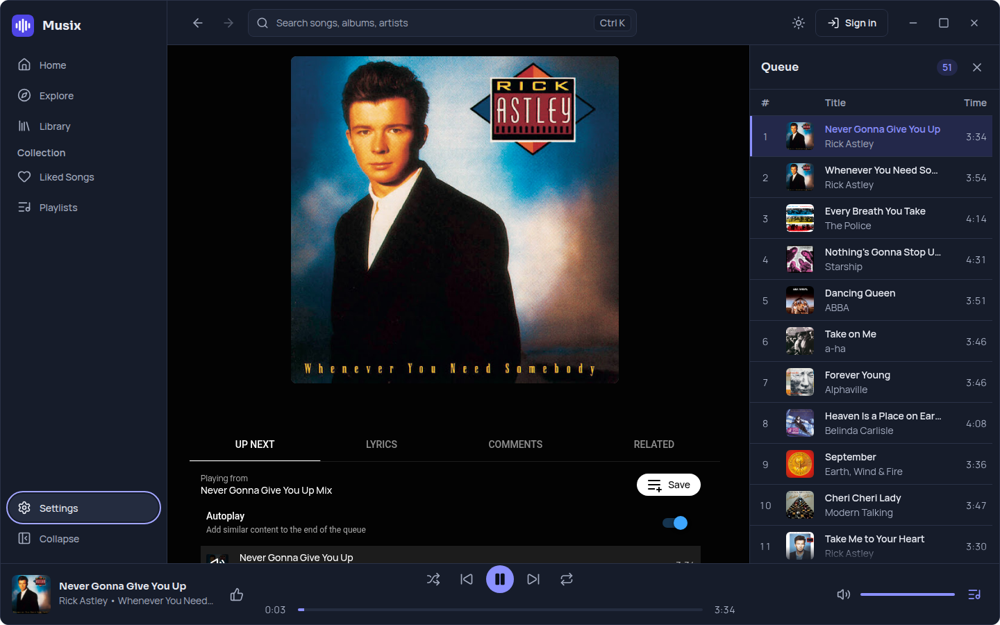
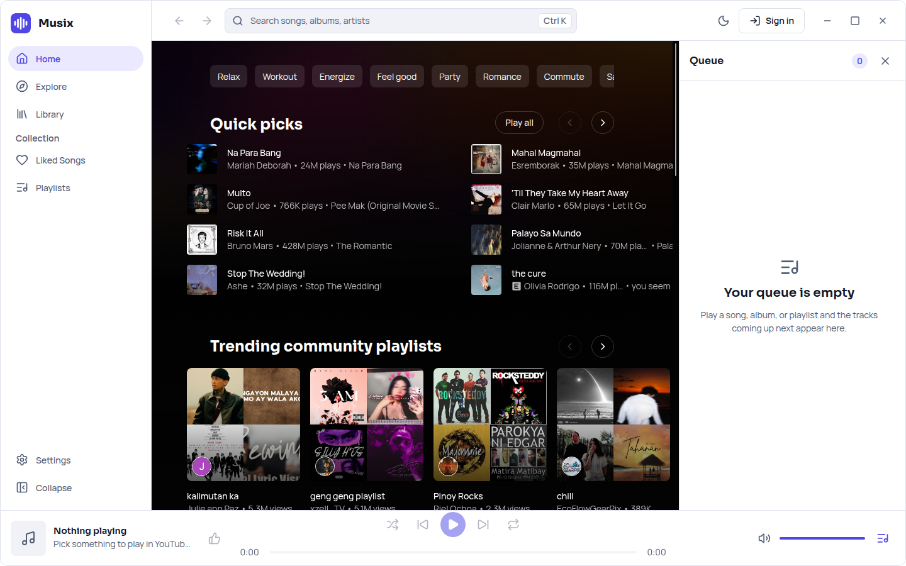
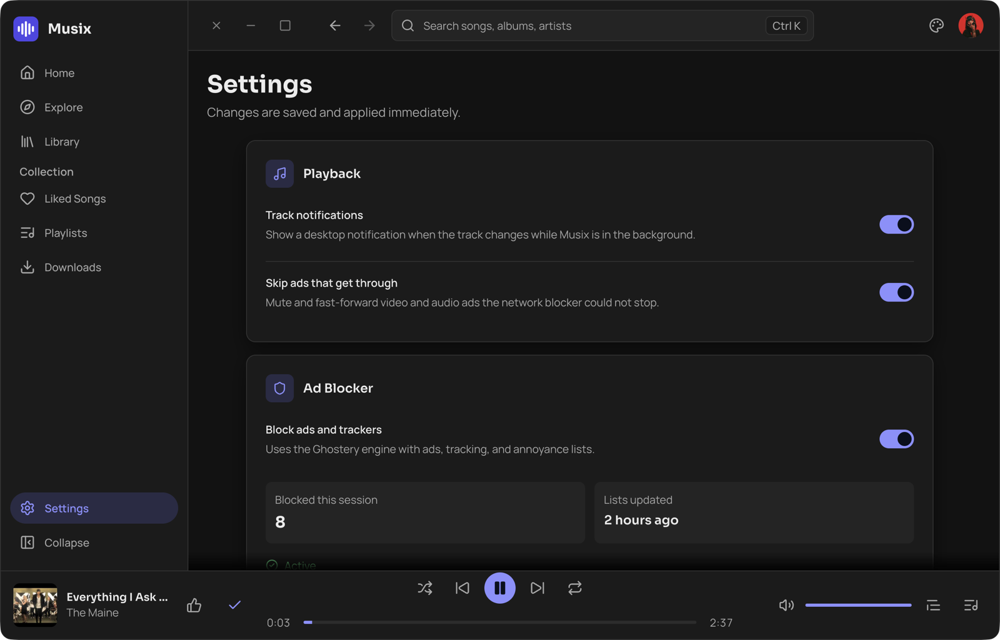
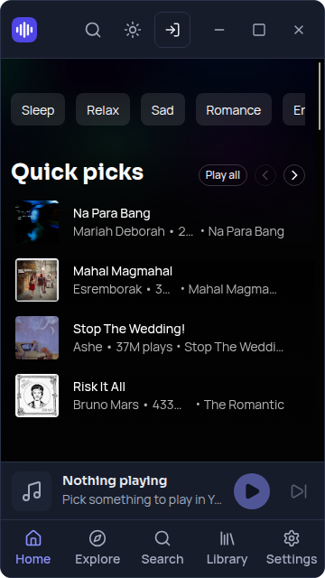
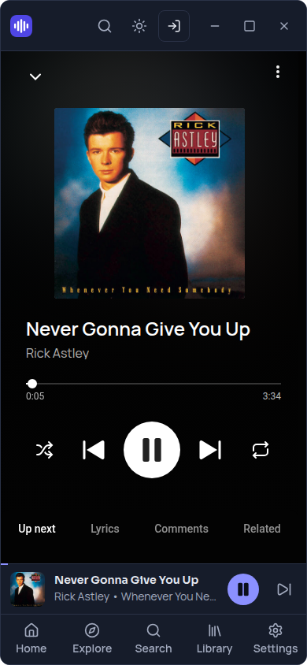
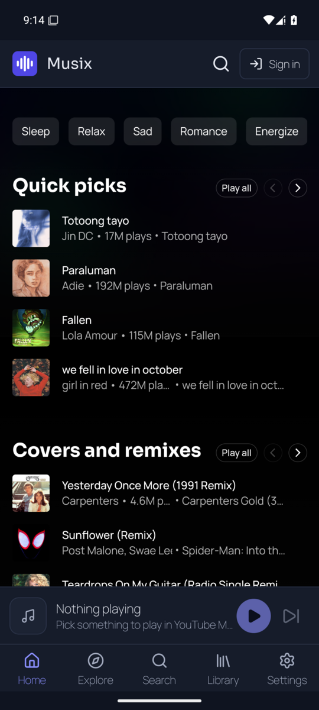
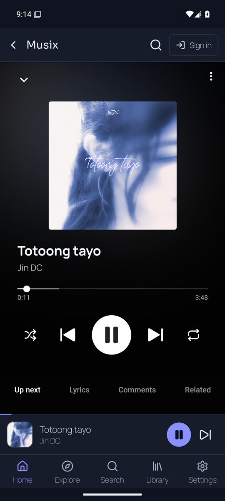
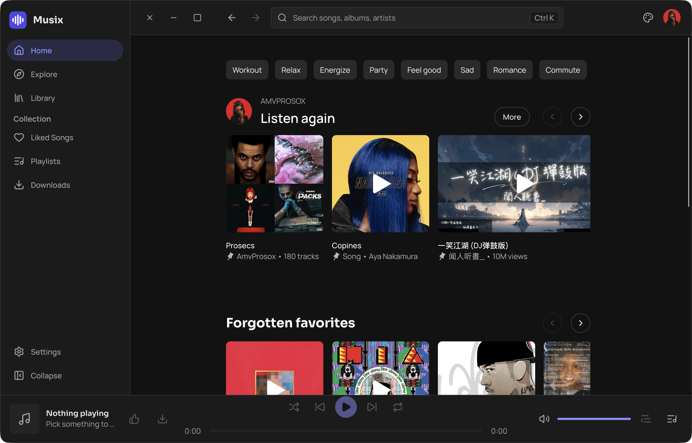

# Musix

A custom music YouTube app with a built-in ad blocker to play what music you wanted to play without subscribing to YouTube 😛. Similar to Youtube Revanced

**New in 1.0.7: you can now download music and listen offline.** Save any song as an MP3, or download a whole playlist, album, or your Liked Music from the Downloads tab, then play it without internet on every platform.

**Testing in 1.0.8 alpha (pre-release): voice control and a better offline mode.**

- **Say "Veru"** (Pro-secs) and Musix answers "Yes", then does what you ask: play a song or playlist, next, previous, shuffle, repeat, like, volume, lyrics, search, open a tab, change the theme, and more. It works offline. Turn it on in Settings, Voice assistant, and download the voice pack once (56 MB).
- **Only your voice.** Teach Musix your voice in a few seconds, and it ignores other people in the room.
- **Pick your microphone.** Musix shows which microphone it is listening with and follows headsets as you plug them in.
- **Edit the commands.** Change the phrases for any action.
- **Free AI for other requests (optional).** Paste your own OpenRouter key, and Musix uses only free models, so it never costs money. Questions that are not about Musix music get a polite no.
- **Offline mode upgrades.** Shuffle plays every song once and Previous goes back to the song you actually heard. Downloads are grouped by playlist, and you can play just one downloaded playlist. Lyrics are saved with each download, so they show offline.
- **New themes.** Midnight, Graphite, Slate Grey, AMOLED Black, and Light.

## Download

Get the files from the [latest release](https://github.com/amvprosox/musixGoogle/releases/latest):

| Platform | File |
| --- | --- |
| Ubuntu | `Musix-1.0.7-amd64.deb` or `Musix-1.0.7-x86_64.AppImage` |
| Windows | `Musix-Setup-1.0.7.exe` or `Musix-Portable-1.0.7.exe` |
| macOS | `Musix-1.0.7-mac.dmg` or `Musix-1.0.7-mac.zip` |
| Android | `Musix-1.0.7-android.apk` |
| Android Automotive | `Musix-1.0.7-android-automotive.apk` |
| iOS | `Musix-1.0.7-ios.ipa` |

## Install on Ubuntu

```bash
sudo apt install ./Musix-1.0.7-amd64.deb
```

Run this in the folder where you downloaded the file, then open **Musix** from the app grid.

To use the AppImage instead:

```bash
chmod +x Musix-1.0.7-x86_64.AppImage
./Musix-1.0.7-x86_64.AppImage
```

## Install on Windows

1. Run `Musix-Setup-1.0.7.exe`.
2. If SmartScreen appears, click **More info** then **Run anyway**.
3. Open **Musix** from the Start menu.

`Musix-Portable-1.0.7.exe` runs without installing.

## Install on macOS

Works on macOS 12 or newer, on both Apple Silicon and Intel Macs.

1. Open `Musix-1.0.7-mac.dmg` and drag **Musix** into **Applications**.
2. Run this once in Terminal so macOS allows the app:

```bash
xattr -dr com.apple.quarantine /Applications/Musix.app
```

3. Open **Musix** from Applications or Launchpad.

## Install on Android

1. Copy `Musix-1.0.7-android.apk` to the phone and open it.
2. Allow installs from that source when asked, then tap **Install**.
3. Open **Musix** and sign in.

### Android Auto

1. Open **Settings > Apps > Android Auto > Additional settings in the app** (or open the Android Auto app).
2. Tap **Version** 10 times to unlock developer mode.
3. Open the menu, tap **Developer settings**, and turn on **Unknown sources**.
4. Connect to the car; Musix appears in the Android Auto app launcher.

## Install on iPhone

Requires a computer, a USB cable and a free Apple ID. The app must be reinstalled every 7 days.

1. Download [Impactor](https://github.com/claration/impactor/releases) for your computer.
2. Plug in the iPhone, unlock it and tap **Trust**.
3. Open Impactor, sign in with your Apple ID and enter the code shown on the iPhone.
4. Select `Musix-1.0.7-ios.ipa`, choose your iPhone and click **Install**.
5. On the iPhone, open **Settings > Privacy & Security > Developer Mode**, turn it on and restart.
6. Open **Settings > General > VPN & Device Management**, tap your Apple ID and tap **Trust**.
7. Open **Musix**.

## License

MIT. See [LICENSE](LICENSE).

## Screenshots

### Desktop (Ubuntu, Windows)







### Small window

<p>
  
  
</p>

### Android

<p>
  
  
  
</p>

### macOS



### iPhone

<p>
  
</p>
