# Musix

A custom music YouTube app with a built-in ad blocker to play what music you wanted to play without subscribing to YouTube 😛. Similar to Youtube Revanced

**New in 1.0.7: you can now download music and listen offline.** Save any song as an MP3, or download a whole playlist, album, or your Liked Music from the Downloads tab, then play it without internet on every platform.

**New in 1.0.8 (alpha, [pre-release](https://github.com/amvprosox/musixGoogle/releases/tag/v1.0.8)):**

- **Veru voice assistant.** Say "Veru", then play, pause, next, shuffle, repeat, like, lyrics, search, open a tab or change the theme. Works offline.
- **Exact voice control.** "Set volume to 50%", "forward to 1:00", "rewind 30 seconds".
- **Several commands at once.** "Play Timeless and turn on shuffle". Veru asks back when unclear.
- **Lauren's voice** answers every command.
- **38 languages**, including Tagalog and Taglish.
- **On-screen popup** shows what Veru heard.
- **Music dips while you talk**, then fades back.
- **Your microphone.** Musix uses the mic you pick; Automatic picks the best one.
- **Free AI** for unusual requests, free models only.
- **Offline fixes.** Shuffle plays every song once, Previous goes back correctly.
- **Downloads by playlist**, with offline lyrics and a new Downloads page.
- **Offline mode** dims online-only tabs and links to Downloads.
- **Themes.** Midnight, Graphite (default), Slate Grey, AMOLED Black, Light.
- **Better small screens** and creator info in About.

Desktop (macOS, Windows, Ubuntu) has everything. iPhone and Android have the offline upgrades, themes, layout and basic Veru; the rest comes in 1.0.9.

## Download

Get the files from the [latest release](https://github.com/amvprosox/musixGoogle/releases/latest):

| Platform | File |
| --- | --- |
| Ubuntu | `Musix-1.0.7-amd64.deb` or `Musix-1.0.7-x86_64.AppImage` |
| Windows | `Musix-Setup-1.0.7.exe` or `Musix-Portable-1.0.7.exe` |
| macOS | `Musix-1.0.7-mac.dmg` or `Musix-1.0.7-mac.zip` |
| Android | `Musix-1.0.7-android.apk` |
| Android Automotive | `Musix-1.0.7-android-automotive.apk` |
| iOS | `Musix-1.0.7-ios.ipa` |

## Install on Ubuntu

```bash
sudo apt install ./Musix-1.0.7-amd64.deb
```

Run this in the folder where you downloaded the file, then open **Musix** from the app grid.

To use the AppImage instead:

```bash
chmod +x Musix-1.0.7-x86_64.AppImage
./Musix-1.0.7-x86_64.AppImage
```

## Install on Windows

1. Run `Musix-Setup-1.0.7.exe`.
2. If SmartScreen appears, click **More info** then **Run anyway**.
3. Open **Musix** from the Start menu.

`Musix-Portable-1.0.7.exe` runs without installing.

## Install on macOS

Works on macOS 12 or newer, on both Apple Silicon and Intel Macs.

1. Open `Musix-1.0.7-mac.dmg` and drag **Musix** into **Applications**.
2. Run this once in Terminal so macOS allows the app:

```bash
xattr -dr com.apple.quarantine /Applications/Musix.app
```

3. Open **Musix** from Applications or Launchpad.

## Install on Android

1. Copy `Musix-1.0.7-android.apk` to the phone and open it.
2. Allow installs from that source when asked, then tap **Install**.
3. Open **Musix** and sign in.

### Android Auto

1. Open **Settings > Apps > Android Auto > Additional settings in the app** (or open the Android Auto app).
2. Tap **Version** 10 times to unlock developer mode.
3. Open the menu, tap **Developer settings**, and turn on **Unknown sources**.
4. Connect to the car; Musix appears in the Android Auto app launcher.

## Install on iPhone

Requires a computer, a USB cable and a free Apple ID. The app must be reinstalled every 7 days.

1. Download [Impactor](https://github.com/claration/impactor/releases) for your computer.
2. Plug in the iPhone, unlock it and tap **Trust**.
3. Open Impactor, sign in with your Apple ID and enter the code shown on the iPhone.
4. Select `Musix-1.0.7-ios.ipa`, choose your iPhone and click **Install**.
5. On the iPhone, open **Settings > Privacy & Security > Developer Mode**, turn it on and restart.
6. Open **Settings > General > VPN & Device Management**, tap your Apple ID and tap **Trust**.
7. Open **Musix**.

## License

MIT. See [LICENSE](LICENSE).

## Screenshots

### Desktop (macOS, Windows, Ubuntu)


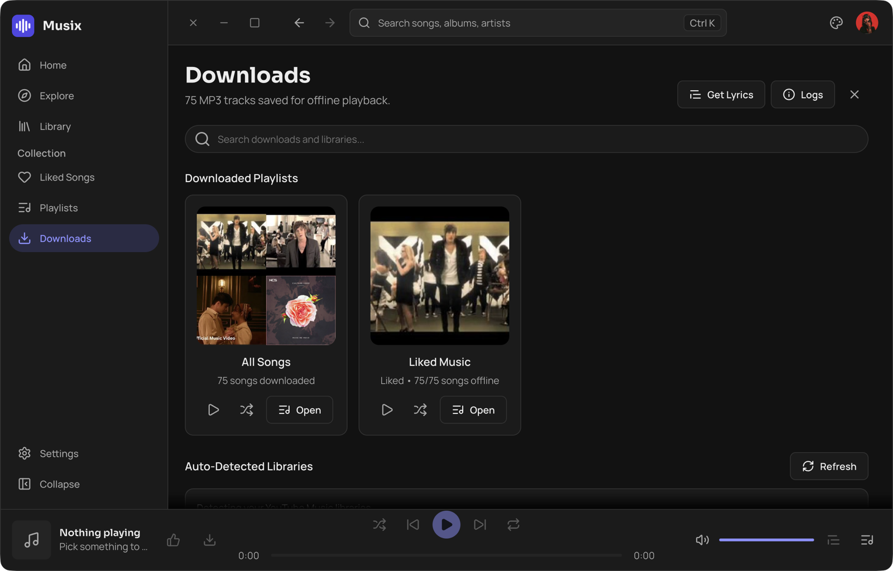

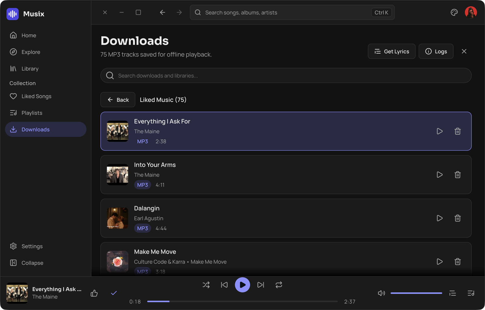

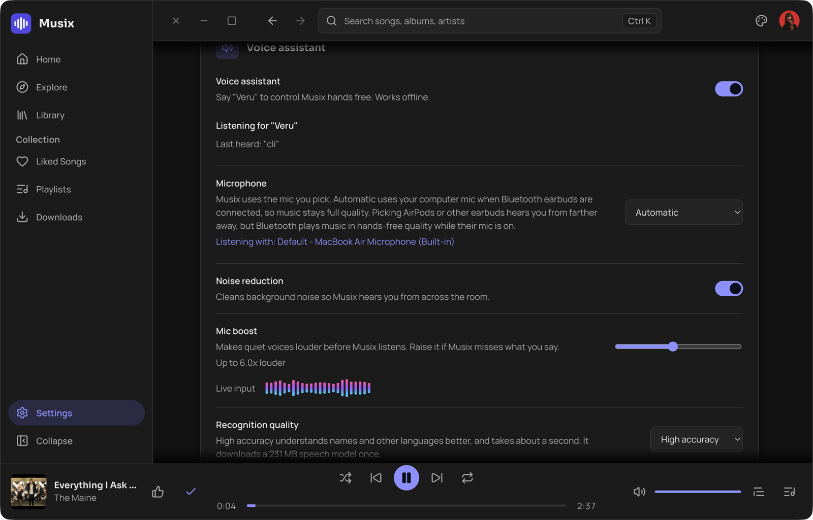

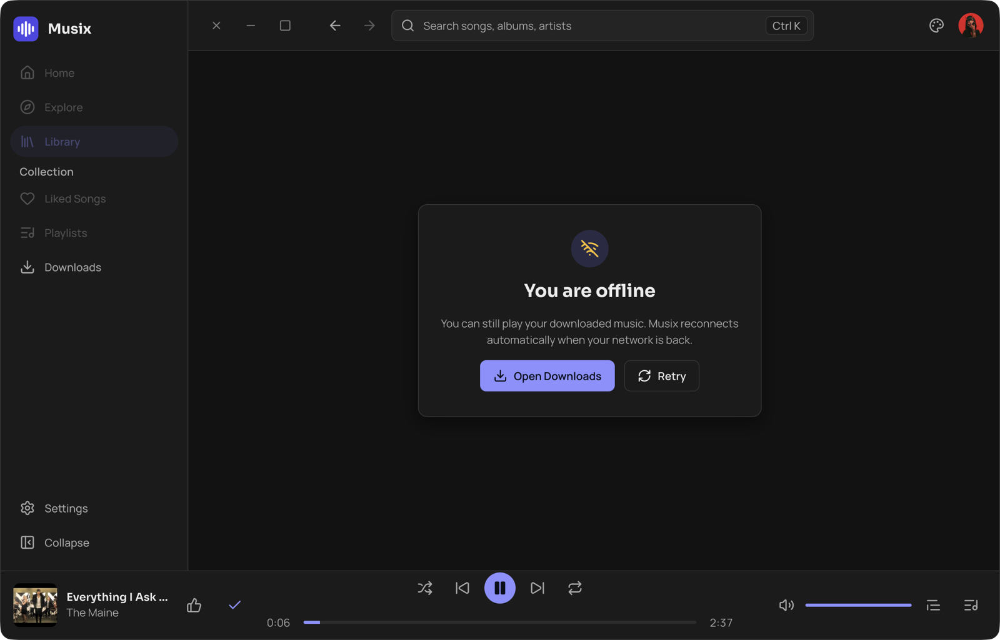

### Tablet size

<p>
  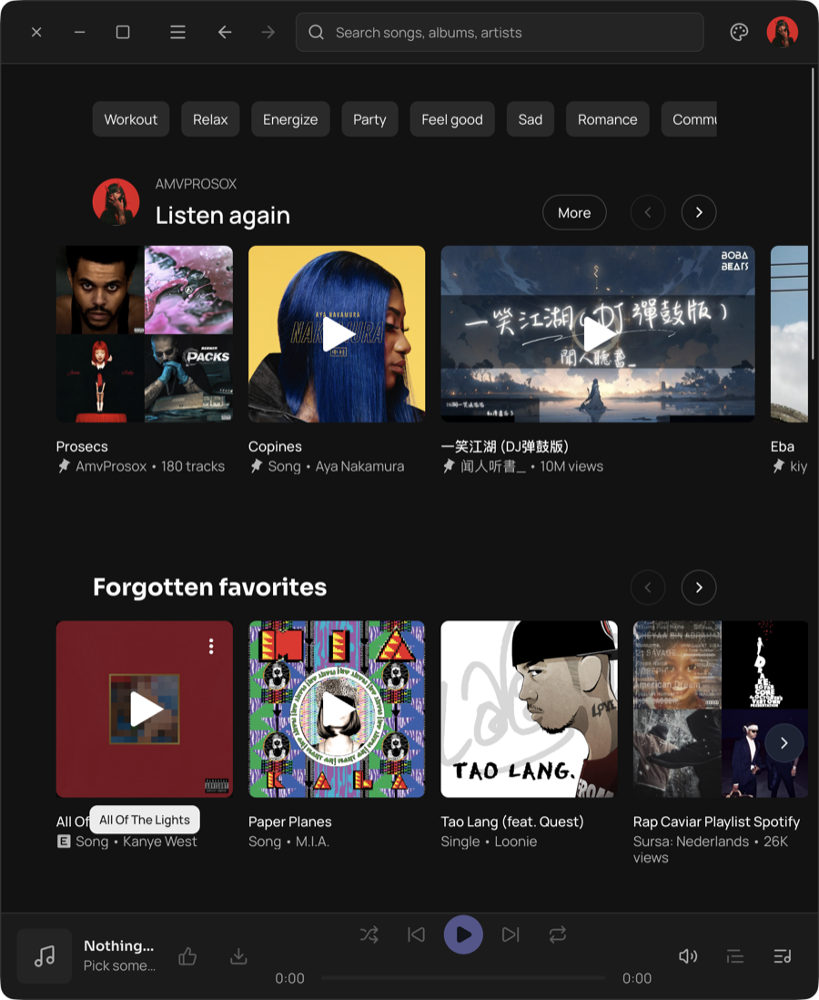
  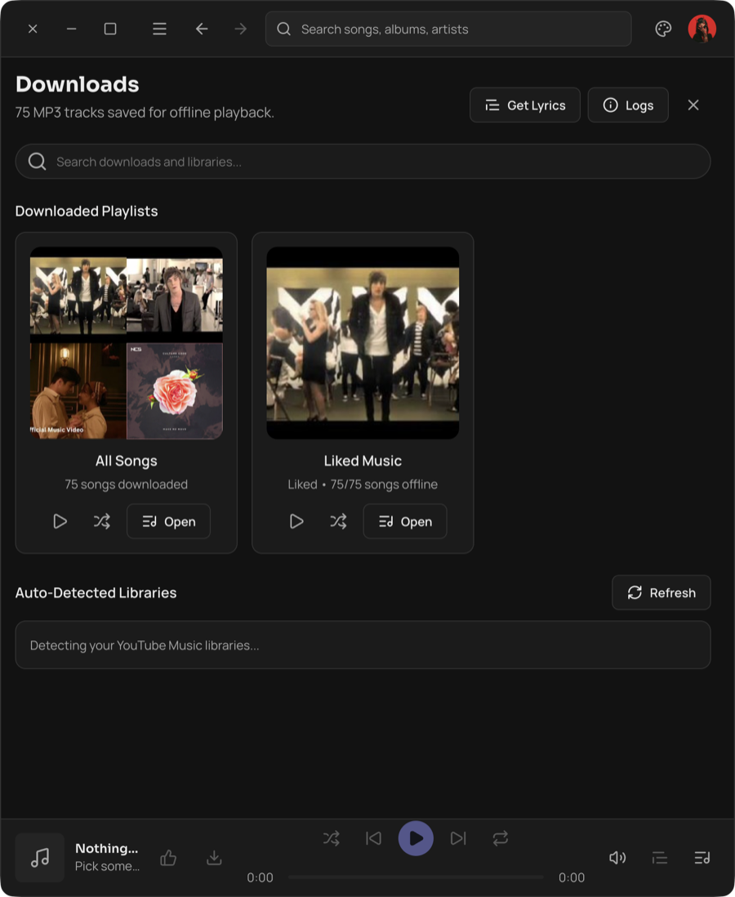
</p>

### Phone size

<p>
  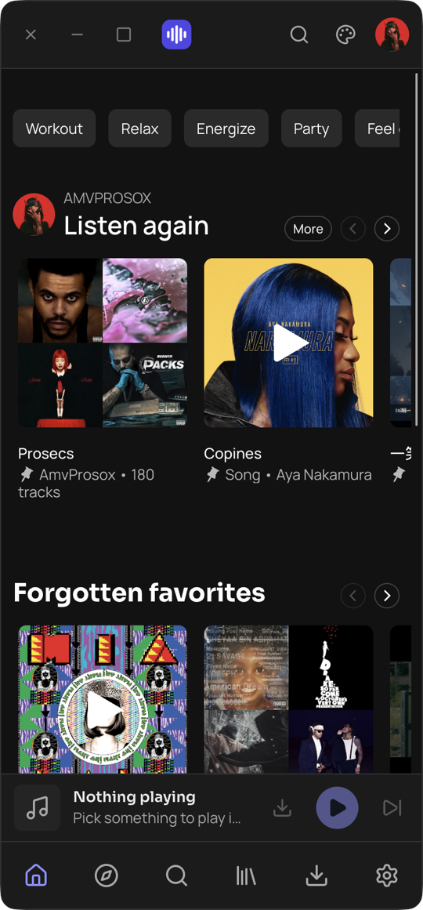
  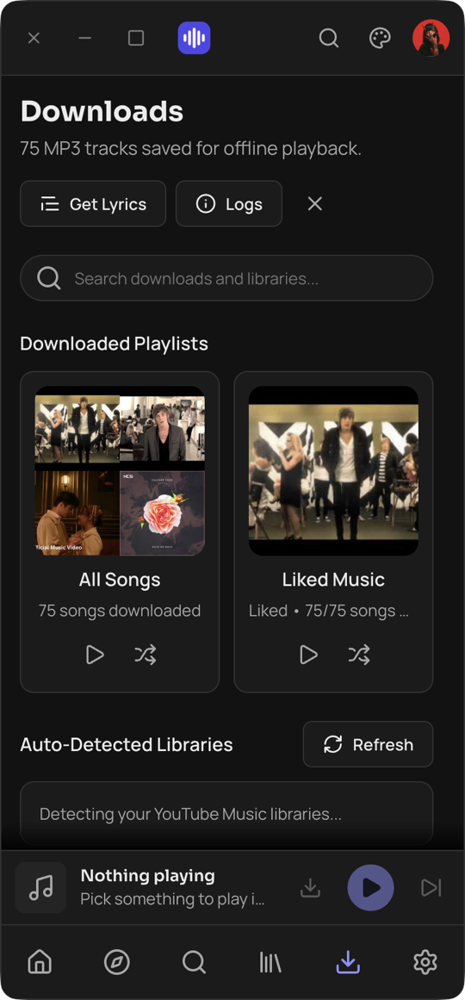
  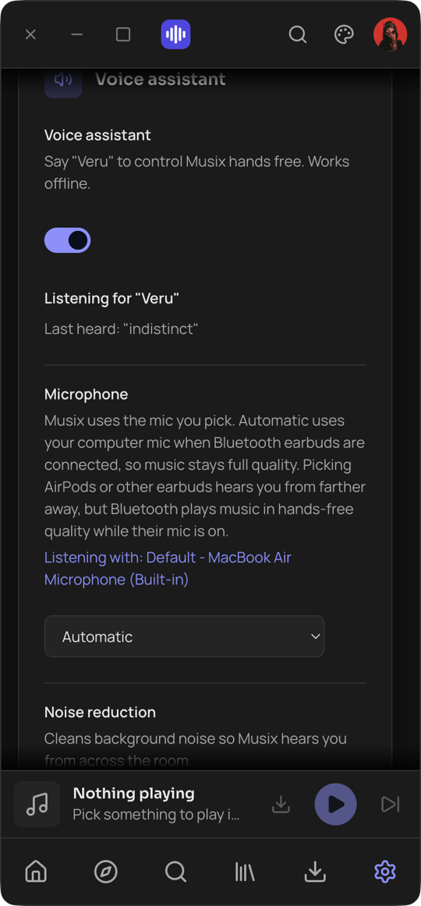
</p>

### Android

<p>
  
  
  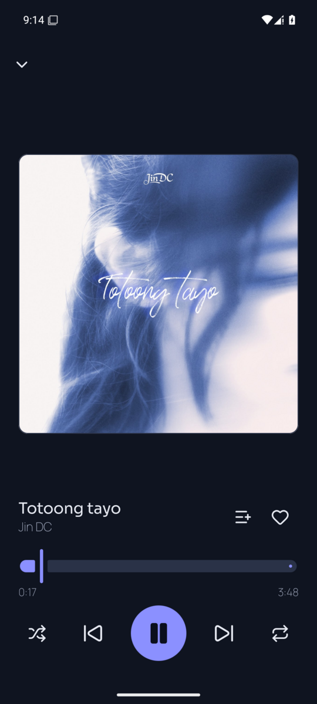
</p>

### iPhone

<p>
  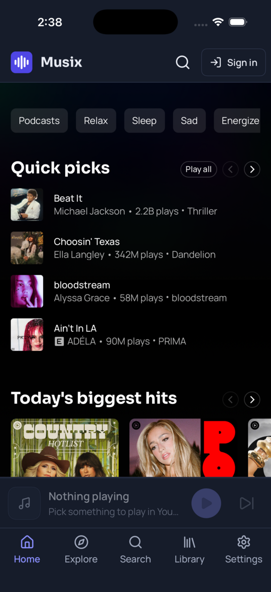
</p>
